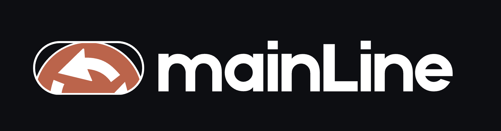

  

<em>Model promotion on rails — contract, gates, canary, rollback.</em>

  
  
  

## About

`mainline` is a self-hosted MLOps platform for taking a model from raw data to a served, monitored, reversible prediction — without per-model re-engineering.

It is **model-agnostic**. Any model that satisfies a small contract (declared input schema, versioned artifact, golden evaluation set, calibration artifact, cost matrix, model card) runs through the same pipeline, the same gates, and the same delivery path.

The reference workload is a tabular churn classifier. A text classifier is added later to prove the contract generalizes. A GPU serving path is added after the CPU path is stable.

## Why it exists

Most model deployments fail in the same three places:

| Failure | Consequence | mainline's answer |
|---|---|---|
| Promotion by metric threshold | Noise ships as improvement | Pre-registered statistical gates |
| All-or-nothing deploys | Regressions found by users | Canary with automatic rollback |
| No drift or performance signal | Model decays silently | Drift and delayed-label monitoring |
| Correct model, wrong threshold | Business loses money anyway | Expected-value decision policy |
| Every project rebuilds plumbing | Months of setup per model | Golden-path template |

## Status

Early development. Nothing in this repository is production-ready yet. Architecture decisions are being written before implementation; see [`docs/adr`](docs/adr).

## Planned capabilities

- Versioned data contracts and reproducible dataset snapshots
- Feature platform with point-in-time joins and offline/online parity tests
- Training pipelines with run manifests and deterministic replay
- Model registry with aliases and PR-based promotion
- Statistical, calibration and fairness gates before promotion
- Cost-sensitive decision policy, evaluated on business value
- Kubernetes serving with canary analysis and automatic rollback
- Observability: traces, SLOs, drift reports, alert-to-runbook links
- Multi-tenant isolation with per-tenant cost attribution
- GPU serving path with batching, utilization monitoring and scale-to-zero
- Golden-path template so a new model ships in under a day

## Stack

Python · Dagster · MLflow · Feast · Iceberg · KServe · Triton · Argo CD · Argo Rollouts · Prometheus · Grafana · OpenTelemetry · Terraform · Kubernetes

## Repository layout

apps/        platform API, inference router, decision service
pipelines/   data, features, training, evaluation, monitoring
packages/    shared contracts, features, evaluation, policy, observability
models/      reference workloads
deploy/      manifests, overlays, GitOps
infra/       Terraform modules and environments
docs/        ADRs, runbooks, SLOs, benchmarks, postmortems
bench/       load-test harness and published results
templates/   golden-path project template

## Documentation

| Document | Purpose |
|---|---|
| [`docs/adr`](docs/adr) | Architecture decisions and rejected alternatives |
| [`docs/slos.md`](docs/slos.md) | Service level objectives and error budget policy |
| [`docs/runbooks`](docs/runbooks) | Symptom, diagnosis, remediation |
| [`docs/benchmarks`](docs/benchmarks) | Reproducible performance and cost results |

## Contributing

The platform is being built with a small team of engineers as a teaching vehicle. Issues and design discussion are welcome; implementation conventions live in [`CONTRIBUTING.md`](CONTRIBUTING.md).

## License

MIT. See [`LICENSE`](LICENSE).